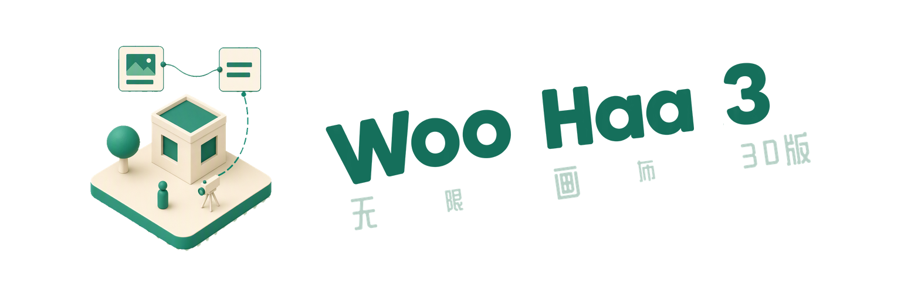
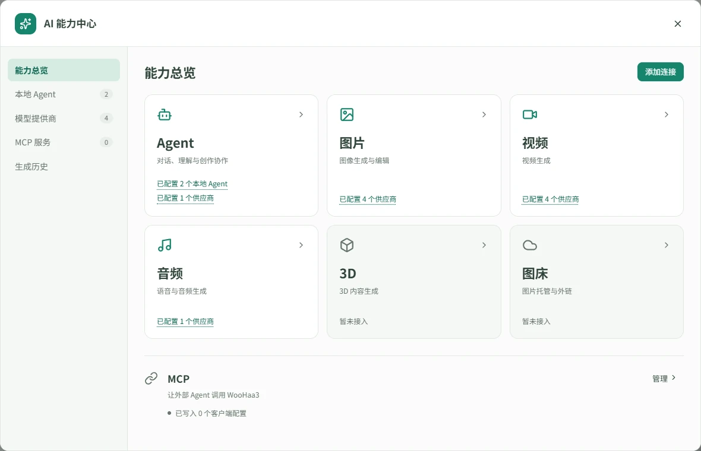
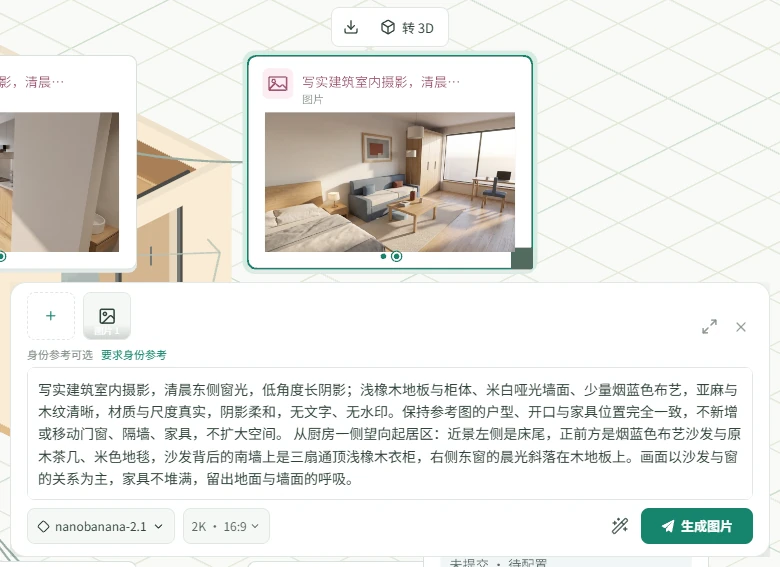
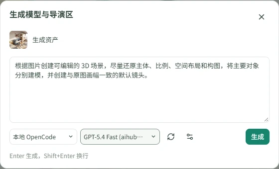
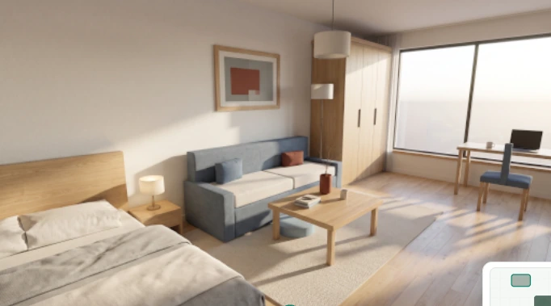
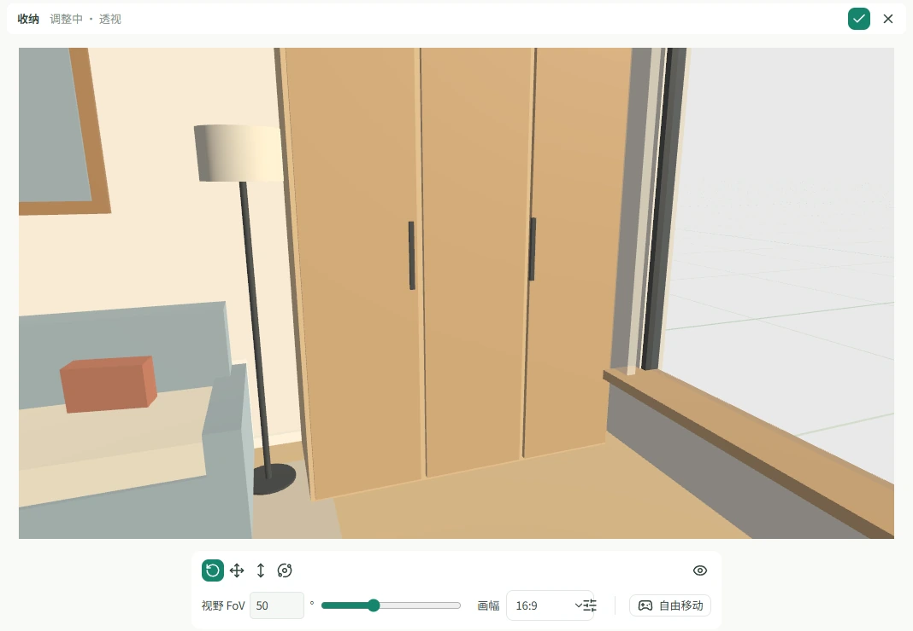
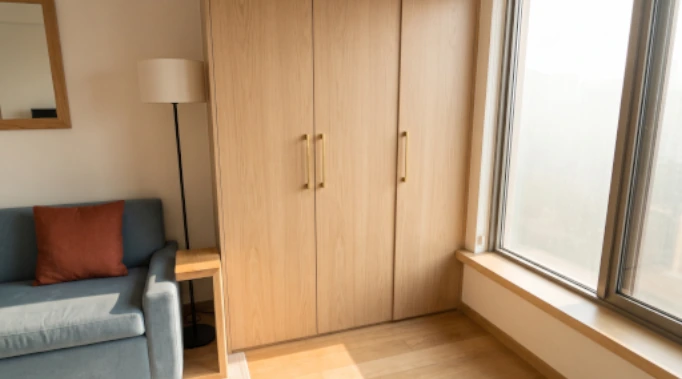

  

  
  

<h2 align="center">
  <a href="http://woohaa3.zombee.tech/download">下载</a> ·
  <a href="http://woohaa3.zombee.tech/">官网</a> ·
  <a href="http://woohaa3.zombee.tech/doc">教程</a> ·
  <a href="https://github.com/woohaa3/woohaa3/issues">反馈</a>
</h2>

WooHaa3 是一款画布式多媒体创作工作台。将文本、图片、音频、视频和 3D 素材放在同一个工作空间，围绕素材完成 AI 生成、编辑和版本追踪。

## 你可以做什么

- **组织多媒体素材**：将文本、图片、音频、视频和 3D 素材放入同一张画布，关联参考素材与创作结果。
- **使用 AI 生成内容**：选择模型、填写提示词，结合已有素材生成新的作品。
- **继续编辑与迭代**：编辑图片、为视频截帧或添加标注，将结果用于下一轮创作。
- **创作 3D 场景与镜头**：组织模型、调整镜头，将取景画面用作图片或视频生成的参考。

## 跟其他画布有什么不同

- **将 3D 导演台直接和画布融合在一起**

  白模预演不再是和画布完全割裂的导演台。可以在一个画布生并行组织 3D 场景、镜头和素材，直接将取景画面作为图片或视频生成的参考。
- **对本地 Agent 极为友好**

  支持调用本地 Agent 来进行画布编排。直接用本地 Agent 生成 3D 模型。能将本地 ChatGPT 的图片直接生成到画布上。
- **极其方便自定制的插件系统**

  通过插件系统可以接入各种模型服务，支持自定义模型。插件可以直接在画布中使用，无需切换到其他应用。
- **深度结合 Photocraft**

  图片节点双击即可进入和 Photoshop 基本一致的界面，进行图片精修。

## 快速入门

### 1. 配置模型服务

进入应用，在弹出的 AI 能力中心连接本地 Agent，或者是，填写一个第三方服务的 API Key。然后在插件详情中查看可用模型，确认需要的模型已启用。

WooHaa3 通过扩展接入模型服务，包括 RunningHub、火山方舟、fal、Replicate 等。实际可用的模型、参考类型和参数取决于所选服务与账号权限。

素材整理可以直接在本机进行，无需接入远端 WooHaa3 服务端。调用外部模型需要对应的账号、凭据和网络连接，费用由相应服务决定。

### 2. 填写提示词，生成你的第一张图

创建节点，在生成面板选择模型并填写提示词。添加模型支持的参考素材，检查必填参数后执行生成。

例如，以一张图片作为参考，描述希望保留的主体和需要改变的背景，再选择支持图片参考的模型生成新图。参考图片的数量、尺寸及支持方式以当前面板为准。

### 3. 真正的三维画布：将图片转为 3D，调整镜头，得到另一个角度的白模参考图

图片生成完成后，选中图片并点击「转 3D」。在弹出的面板中选择支持图片输入的助手，确认场景描述后生成模型与导演区，搭建对应的三维场景。

在导演场中选中镜头，点击「编辑」，调整拍摄角度、距离与构图，保存新的取景。然后将镜头取景作为参考，配合原图和提示词再次生成图片，就可以尝试得到同一主体、同一场景的另一个角度版本。

例如，从床、沙发与窗户的全景，切换到衣柜近景：床离开画面，衣柜成为构图主体。

| 原图视角：房间全景 | 新镜头取景：衣柜近景 |
| --- | --- |
|  |  |

### 4. 根据白模参考图和原图组合参考，生成新的画面

根据原图和白模参考图的组合，调整提示词，生成新的画面。下图展示同一房间的衣柜近景成图，与上一步的新镜头取景对应。

完整操作说明见[使用文档](http://woohaa3.zombee.tech/doc)。

## 许可证与致谢

WooHaa3 原创代码以 [MIT 许可证](LICENSE)发布。
